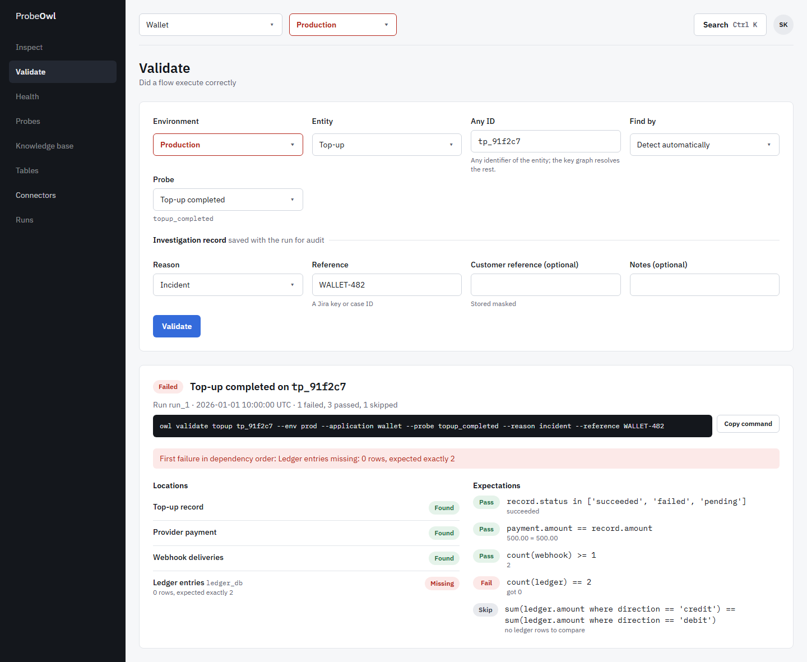
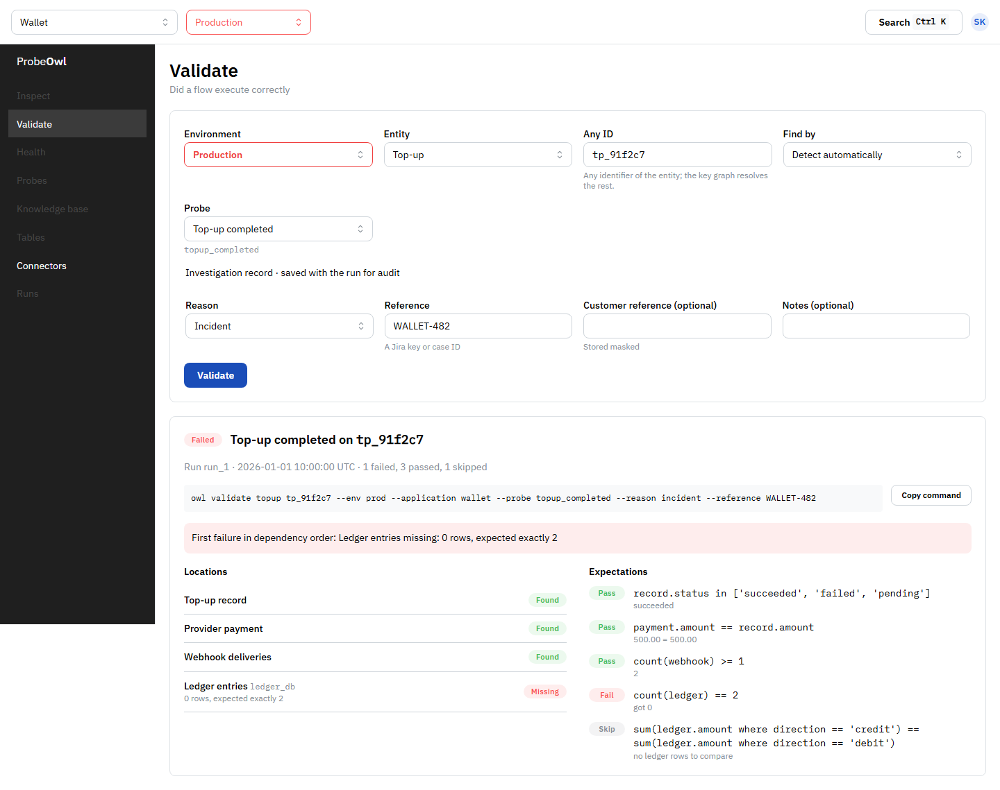
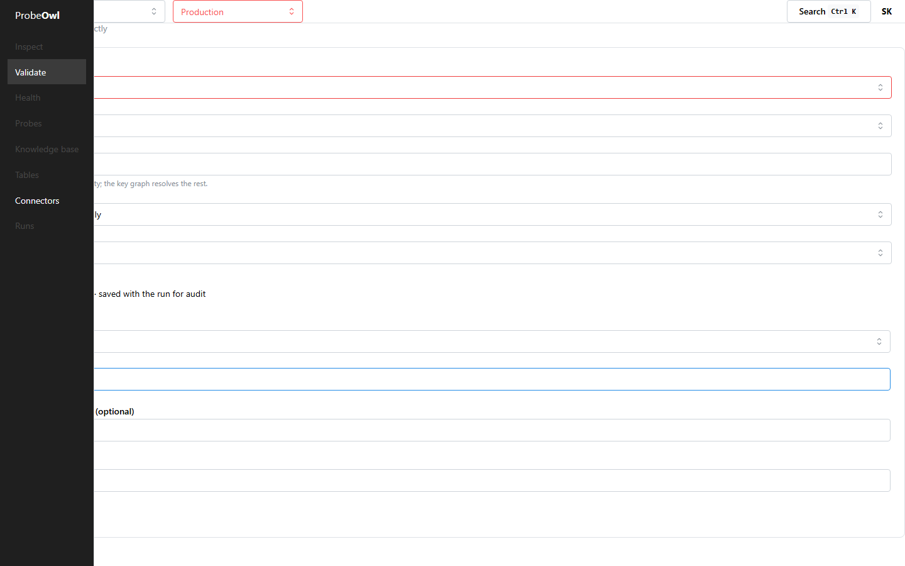

# UI foundation: shadcn/ui, the rules and the plan

Phase 0 of the UI foundation (#105) rebuilt Validate and Connectors twice, on throwaway branches,
with the same data and mocks: once with **shadcn/ui** (Radix and Tailwind, the components copied
into this repository) and once with **Mantine 8**. shadcn/ui was chosen; `docs/decisions.md`
records why. This page keeps the comparison, the rules every screen follows, and the plan that
moves the screens onto `web/src/ui`.

## The trial

Measured on develop as of 15 Nov 2026, with the same script on both trials: each build served
under each CSP, in Chromium at 1440 and 390 px, light and dark.

| Measured | shadcn/ui trial | Mantine 8 trial | v0.2.0 |
| --- | --- | --- | --- |
| Loaded up front, gzipped | 120.7 KB (JS 113.5, CSS 7.2) | 159.0 KB (JS 129.7, CSS 29.3) | 314.7 KB (JS 306.0, CSS 8.6) |
| What that covers | The trial page: React, Router, Query, the API client, a shell, Validate and Connectors. The 38 KB between the two trials is the library | The same | Every screen, CodeMirror included |
| CSP as `owl serve` sends it (`style-src 'self' 'unsafe-inline'`) | No violations | No violations | None |
| Strict CSP (`style-src 'self'`) | Works. Two violations on Validate, both from Radix Select's injected `<style>`; a native `<select>` removes them | **Breaks.** Seven violations: Mantine injects its CSS variables and responsive styles as `<style>`, Validate's layout falls apart and the form can't be submitted. It needs `'unsafe-inline'`, or a nonce on every page | One, in the probe editor (CodeMirror) |
| Field height | 40 px everywhere | 36 px everywhere (size `sm`) | 38, 40, 42 and 74 px |
| Sideways scroll at 390 and 1440 | None | None | Tables at 390: Inspect, Tables, Connectors |
| React | Radix works on 18 and 19 | 8.3 on 18; Mantine 9 needs React 19 (#34) | 18.3 |
| Licences | Tailwind, Radix, tailwind-merge and clsx: MIT. class-variance-authority: Apache-2.0. shadcn/ui is code we copy in and own | @mantine/core and hooks: MIT | Radix: MIT |
| What we maintain | Our own copy of each component, as small files in `web/src/ui` | Nothing of the components; Mantine's upgrades and its CSS | |

Validate with a failed run at 1440 px, shadcn/ui first, then Mantine 8:

Mantine's Validate under `style-src 'self'`: the shell's sizes and the form grid's columns never
arrive, and the form can't be submitted. shadcn/ui renders as above under the same policy.

## The rules

Ten rules, each kept by a test. `web/e2e/ui-rules.spec.ts` holds the components in `web/src/ui`
to them on a gallery that only mock builds serve; `web/e2e/screen-rules.spec.ts` holds every
screen to them, marking what a screen still breaks with the PR that moves it.

| Rule | What it says | The test that keeps it |
| --- | --- | --- |
| 1. Spacing scale | 4 px steps only: 4, 8, 12, 16, 24, 32, 48. No other gap, margin or padding | Lint: padding, margin and gaps off the scale are refused everywhere, and arbitrary values (`gap-[…]`, `[overflow-wrap:…]`) outside `web/src/ui` |
| 2. One field height | Inputs, selects and buttons in forms are 40 px; small (32 px) only for toolbars and Copy | e2e: every control in a form row has the same height (±1 px) |
| 3. The form grid | Each field is three rows: the label, a 40 px control, then a row kept for help or an error. One column below 640 px, two from 640, four from 1280 | e2e: showing an error leaves every other control where it was |
| 4. Sans for the UI, Mono for code | IBM Plex Sans for everything, headings included; Plex Mono only for code, IDs, expressions and commands, as a span inside the sentence | e2e: no h1 to h4, legend or table header is in Plex Mono |
| 5. A menu below 1024 px | The sidebar from 1024 px; below that a Menu button opens it as a sheet. The top bar is at most two rows; below 640 px the selects take a row of their own, and the user never wraps alone | e2e at 1023 and 1024 px and narrower: the sidebar or the Menu button, never both, and the top bar's rows |
| 6. No sideways scroll | Tables from 768 px; below that, the same rows as cards. Nothing reaches past the screen's edge | e2e: every screen and state at 320, 390, 768 and 1024 px, including content clipped inside a container |
| 7. Code blocks | Commands and queries wrap at any character inside their block. Copy sits beside the block from 640 px and below it under that, never over it | e2e: with a 200-character ID, Copy's box and the code's box don't overlap |
| 8. One button | One Button component; a link that acts as a button uses its classes, with no underline. A disabled button says why, next to it | e2e: each disabled submit has a visible reason, and a button link has no underline |
| 9. One chip | Status chips are one size (24 px), sentence case, one colour per outcome, the same in every table and card | e2e: every chip on a screen is the same height and never clips its text |
| 10. Both themes, by tokens | Brand colours as tokens, light and dark, following the system setting (#47); Production red stays red in both. No literal colour in a component | axe on every screen, light and dark; Tailwind's own palette is removed, so only the tokens in `web/src/ui/ui.css` exist as colours |

## The plan

Six PRs, about 12 days, in v0.2.x before v0.3. Each carries screenshots at 1440, 1024 and 390 px
and a full e2e run, and none changes the contract. The numbers are the audit's items in #105.

| PR | What | Audit items | Status |
| --- | --- | --- | --- |
| 1. Foundation | Tailwind 4 and the tokens, light and dark, beside `app.css`; `web/src/ui` (Button, Field, Input, a native Select, Badge, Card, CodeBlock, Sheet, ListOrTable); the rule tests | 19 | Merged, #131 |
| 2. Shell | The sidebar and Menu, a top bar of at most two rows, the shell on the tokens (#47 begins) | 1, 2, 3 | Merged, #136 |
| 3. Run screens | Validate, Inspect, the run result (its command, mono IDs inside Sans titles), the healthy comparison and the next steps | 5, 7, 8, 10, 11, 15, 16 | #139 |
| 4. Setup and connections | Setup (#102), Add connection, Connectors and Tables: tables become cards below 768 px; one chip | 4, 6, 9, 12, 18 | Next |
| 5. Editors and the rest | The probe editor, entity wizard, knowledge base, runs, audit, search and Compare files | 13, 14, 17 | Planned |
| 6. Finish | `app.css` removed, the dark theme switched on (#47 closes), every rule test required. Then, as its own change: a per-request style nonce for CodeMirror and for the Sheet's scroll lock, and `'unsafe-inline'` dropped from `owl serve`'s CSP | 20 | Planned |

The CSP change in PR 6 touches `backend/probeowl/api/web_app.py`, so it waits for a maintainer's
approval.
