# v0.3: the entity graph

v0.3 is phase (b) of **No YAML required**: the entity graph builder (#29). This note records phase 0,
which was design only: the screens, the renderer trial, the safety rules, the contract changes,
the newcomer estimate and the plan, with the decisions taken on 22 Nov 2026. Each part gets its
exact behaviour in its own reviewed PR. What ProbeOwl does and why is in [design.md](design.md); the
roadmap is in [implementation-plan.md](implementation-plan.md); v0.2 is in [v0.2.md](v0.2.md).

## What it is

New entity becomes one screen, the **entity graph**, in place of the wizard's five steps. The graph is
built against a **sample**: one real subject's ID. Each box is a location and each arrow the key it
takes. Every box shows its outcome on the sample, so a Missing or Blocked location shows before any
probe is written.

- **Root table, entity id, sample ID.** The id comes from the table's name. The sample can be any
  identifier; the root key is the usual one.
- **Boxes and arrows.** A box shows the location's title, its connector and table or path, its
  cardinality, and its outcome on the sample with a reason ("1 of 2 cards: C104577 not on the
  controller"). An arrow is labelled with its key field.
- **Live as you edit,** outside Production. Each change looks the sample up again: the boxes show
  Checking, then their outcome. "Last check" sums them up, for screen readers too.
- **Follow a key.** The selected box offers likely next tables, each saying why: a catalog link,
  `<table>_id` to that table's primary key, the same field on another connector, or a REST lookup
  form.
- **Fixes on the box.** A missing label or link shows on its box as a fix. The fix's panel says what
  it writes, then writes through the catalog's own preview.
- **Identifiers by ticking.** Any exposed field can be ticked. A pattern is suggested from the
  sample's value, never for PII.
- **The Outline.** The same graph as a nested list in key order, with real buttons. It's the view
  below 1024 px, and what the keyboard and screen readers get at any width. On a phone the graph is
  one press away and scrolls sideways inside its own frame, as the YAML editor does.

Wallet's top-up at 1440 px, built against `tp_91f2c7` in UAT. Webhook deliveries is Missing: the
fault the probe exists to catch, shown before the probe is written. The suggested patterns,
`^tp_[0-9a-z]{6}$` and `^pay_[0-9a-z]{6}$`, are the ones in `examples/wallet`:

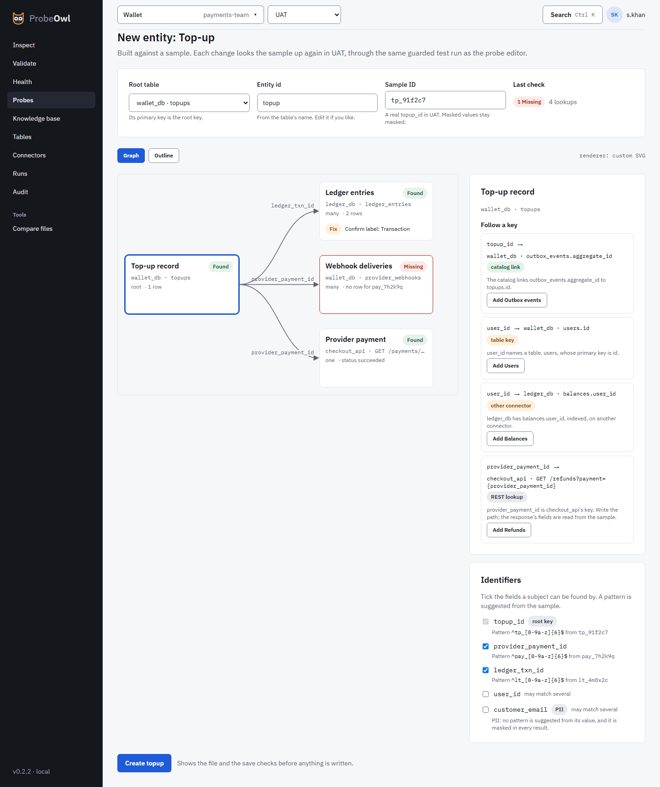

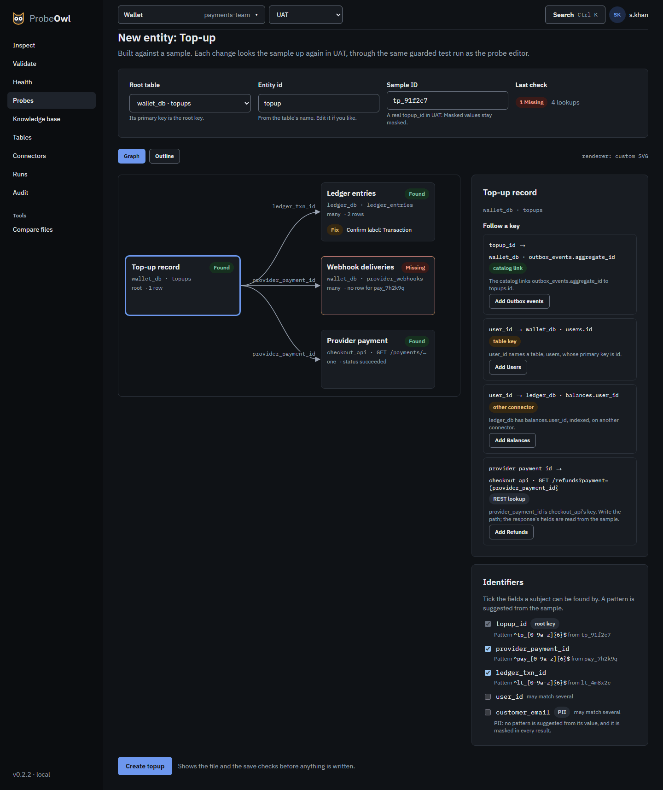

Card access's visitor, with a fan-out: the door controller is looked up for each card, and one of
the two isn't on it:

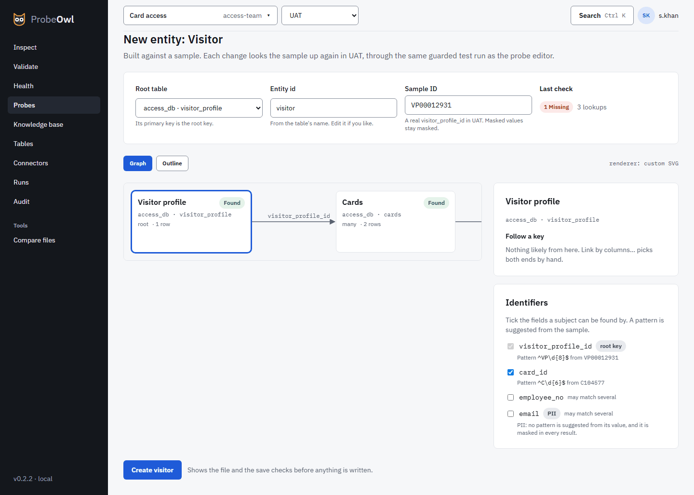

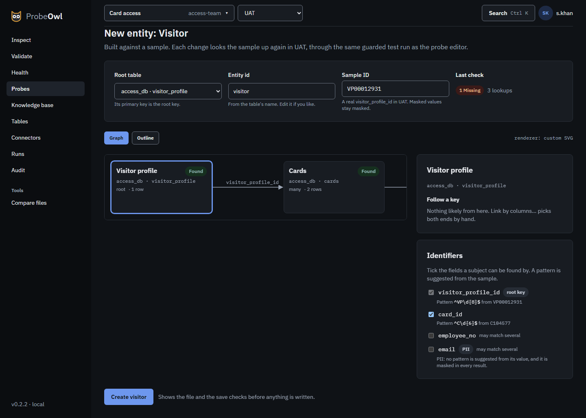

A fix on its box, and a sample that isn't there, where the root is Missing and every other box is
Blocked:

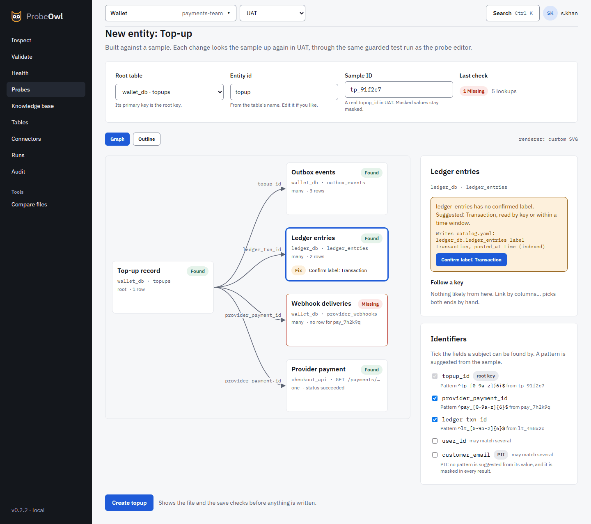

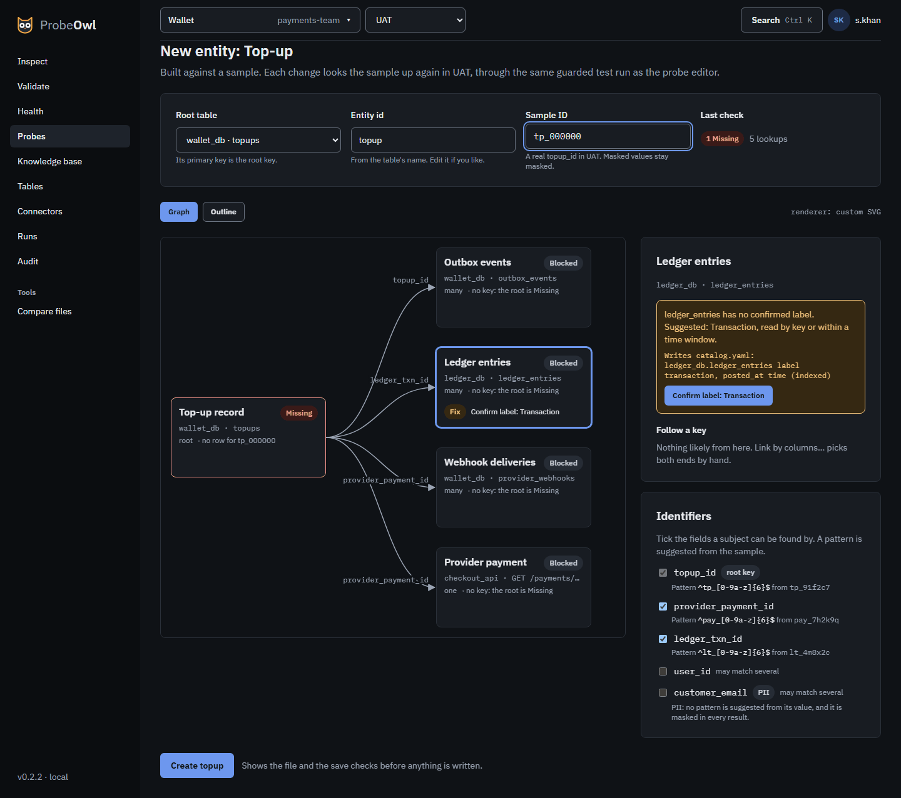

The Outline at 390 px, Card access and Wallet, light and dark:

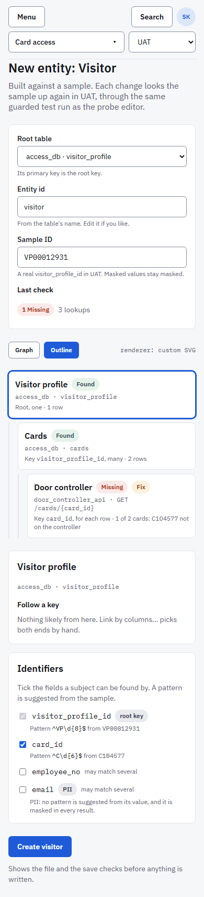 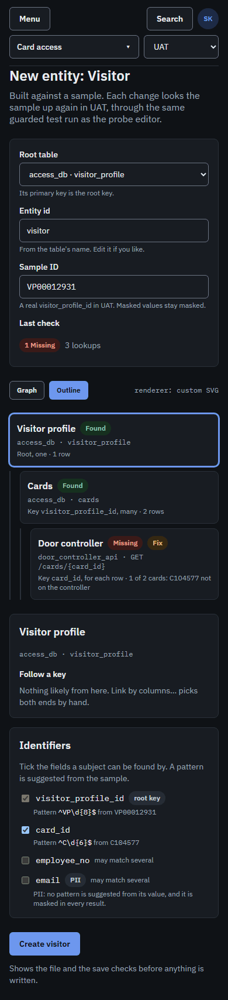 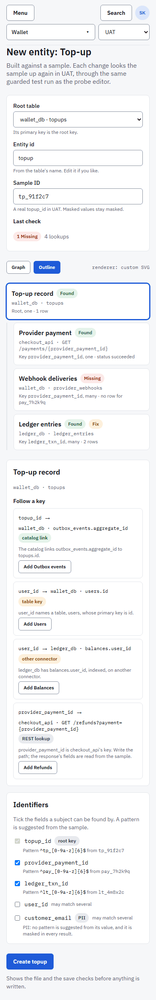 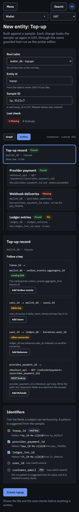

The screenshots are of the phase 0 prototype (branch `cc/29-graph-trial` at d23d2f8, never merged),
served under `owl serve`'s strict policy on mock data. Its lookups were simulated; the product makes
them as described under Safety. Four of the suggested tables are illustrations, not in `examples/`:
`badge_events`, `access_groups`, `users` and `balances`.

## The renderer

Both prototypes drew the same boxes with the same dagre layout; only the renderer differed. Each ran
under `owl serve`'s strict policy (`style-src 'self' 'nonce-…'`, no `'unsafe-inline'`), in light and
dark, at 1440 and 390 px, with axe and a listener for `securitypolicyviolation` events.

| | React Flow (`@xyflow/react` 12.12.1) with dagre | Custom SVG with dagre (`@dagrejs/dagre` 3.1.3) |
| --- | --- | --- |
| Bundle, gzipped | 60.1 KB JS and 3.0 KB CSS, plus dagre's 16.6 KB: **79.7 KB** | 3.3 KB of our code plus dagre's 16.6 KB: **19.9 KB** |
| Licence | MIT; React Flow asks projects that hide its attribution link to subscribe to React Flow Pro | MIT; the rest is our code |
| Strict CSP | No violations: no injected `<style>`, positions through React style props | No violations |
| Keyboard | 7 tab stops for 4 boxes (every edge and box); arrow keys don't move between boxes; Enter didn't select | One tab stop; ← and → follow the keys, ↑ and ↓ move between siblings, Home goes to the root |
| Screen reader | The pane is `role="application"`; edges are named from internal ids; boxes are groups | Boxes are buttons named by what they show; the Outline gives the same as nested lists |
| axe | color-contrast fails on the attribution link, both themes | Clean, both themes, 1440 and 390, Graph and Outline |
| At 1440 px | `fitView` shrinks the boxes until their text is about half size | Full size; the frame scrolls when the graph is wider |

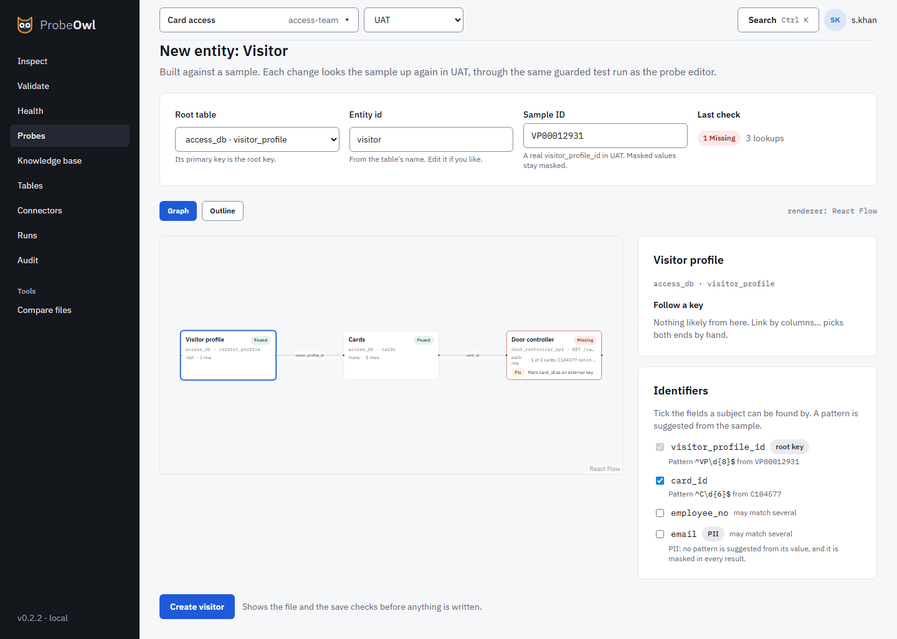

**Layout:** dagre. elkjs lays out better, but is 439.1 KB gzipped and licensed EPL-2.0 or
GPL-3.0-or-later. **Decided:** the custom SVG renderer with dagre, pinned, as a component in
`web/src/ui` with its own rule tests. React Flow brings dragging, zoom and edges edited by hand,
which the graph doesn't need: a box is added through Follow a key, and dagre places it.

## Safety

The graph adds no way to reach a database.

- **The lookup** is a draft test run, the one the probe editor's Test run makes:
  `POST /api/applications/{app}/probes/test-runs` with the draft entity and a generated Inspect
  probe (`expect: count(<root>) >= 1`, since a probe needs one expectation). The runner reads every
  location and reports each as it is read; the graph polls `GET /api/runs/{id}`.
- **Every guard, before any lookup:** the save checks, the row ceiling, fan-out caps, run limits
  (429), the circuit breaker and the kill switches, through the same path as any run. A kill switch
  shows on each box it stops.
- **Masking** happens in the runner; the graph only ever gets masked values.
- **Audit:** each lookup is a stored run, with the actor and a `draft:` probe version. Runs hides
  draft runs by default, with a **Show draft runs** filter (#164).
- **Outside Production, live:** a lookup starts 1 s after the last edit, with at most one in flight
  per page. The graph opens in the application's first non-Production environment.
- **In Production, never live.** Production is allowed, but lookups run only when the person clicks
  **Check sample**. The reason and reference are asked once per session, the red banner shows, and
  the kill switch and circuit breaker apply as usual.
- **Writes:** nothing is written until Create or a fix's button. Each shows the diff first and
  writes with its `base`; nothing is committed or pushed.

## Contract

Each change is its own PR with its code and the regenerated client and mocks, labelled `contract`,
and waits for a maintainer's approval.

| Change | Why | PR |
| --- | --- | --- |
| Save an existing entity: `PUT …/entities/{entity}` with `base` | Today it saves only a new one, so the graph couldn't open an entity that exists and save it | #161 |
| A note on runs, and a warning level in the save checks, for Not configured (#25) | So that a location without a binding in an environment is Not configured, not a refused run | #25 |
| Foreign keys in the imported schema (#26) | Better suggestions; optional, after 0.3 | #26 |

Already covered by existing routes: sample lookups and outcomes (`POST …/probes/test-runs`,
`GET /api/runs/{id}`); a sample matching several subjects (`POST /api/runs/{id}/matches`); save
checks as you edit, with the failing location named (`POST …/probes/checks`, #108's fields); tables
and keys (`GET …/catalog/schema`, `GET …/catalog`, `GET …/catalog/review`); other connectors
(`GET …/connectors`); inline fixes (`PUT …/catalog/tables/{connector}/{table}`); creating the entity
(`PUT …/entities/{entity}`); Production's reason and reference (`investigation` in `DraftRun`).
Pattern suggestions need no route: the browser makes them from the masked values a run returns.

## The newcomer path

Counted as `dev/measure/newcomer_first_run.sh` counts, against 0.2.2's measurement of 21 Nov 2026:

| Step | 0.2.2, measured | With the graph | What changes |
| --- | ---: | ---: | --- |
| Commands, setup, connection, labels, open the web app | 23 / 157 | 23 / 157 | Phase (a); 22 / 157 with #125 in 0.2.3 |
| New entity: visitor and cards | 11 / 15 | 7 / 10 | Probes, New entity, root table, the sample `VP00012931`, Add Cards, Create, Write. The id comes from the table; the four Next buttons and Check go, since the save checks run as you edit |
| New Validate probe | 12 / 82 | 12 / 82 | Phase (c) |
| First Validate | 4 / 10 | 3 / 0 | **Validate on the sample** after saving the probe: a normal audited run, with a reason, and a reference in Production |
| **Total** (actions / characters) | **50 / 264** | **about 45 / 249** | The target was about 42 / 240 |

The sample costs 1 action and 10 characters, so the graph alone gives 46 / 259. The earlier estimate
of "about 6 and none" for the entity step had no sample, and no Found or Missing either. The rest of
the gap is outside phase (b): the probe's first check (82 characters) is phase (c), and the
connection's trust-certificate reason (40 characters) only comes up on a self-signed server. A
sample picker would save the sample's 10 characters, but it is a new query shape: it is part of
#49's phase 0, as a guarded, masked listing.

## Plan

One issue and one PR each, all on develop. Each carries screenshots at 1440 and 390 in both themes,
the strict-policy suite and the full suites on its final commit.

| PR | Issue | What | Days |
| --- | --- | --- | ---: |
| 1 | #160 | This note, the decisions, the Not configured rule in design.md | 0.5 |
| 2 | #108 | The draft run's and save checks' mocks held to the backend's real answers | 1 |
| 3 | #25 | Not configured per location; `--strict`; `owl check` warns instead of refusing (contract) | 2 |
| 4 | #161 | Save an existing entity (contract) | 1.5 |
| 5 | #162 | The graph and Outline in `web/src/ui`, with dagre and their rule tests | 2 |
| 6 | #163, #164 | The graph screen: sample, live lookups, Production's Check sample; Runs hides drafts | 3 |
| 7 | #165 | Follow a key: every kind of suggestion | 2 |
| 8 | #166 | Fixes on the box; identifiers by ticking with suggested patterns | 2 |
| 9 | #167 | Open an existing entity in the graph and save it | 1.5 |
| 10 | #168 | The newcomer path, Validate on the sample, the guide, `dev/measure` | 1.5 |
| | | **Total** | **17** |

Outside phase (b): #125, #128, #149 and #151 go in 0.2.3; #26 in 0.3.x; #49 (search entry points)
in 0.4.x and #50 (batch runs) in 0.5.x, each with a phase 0 of its own.
