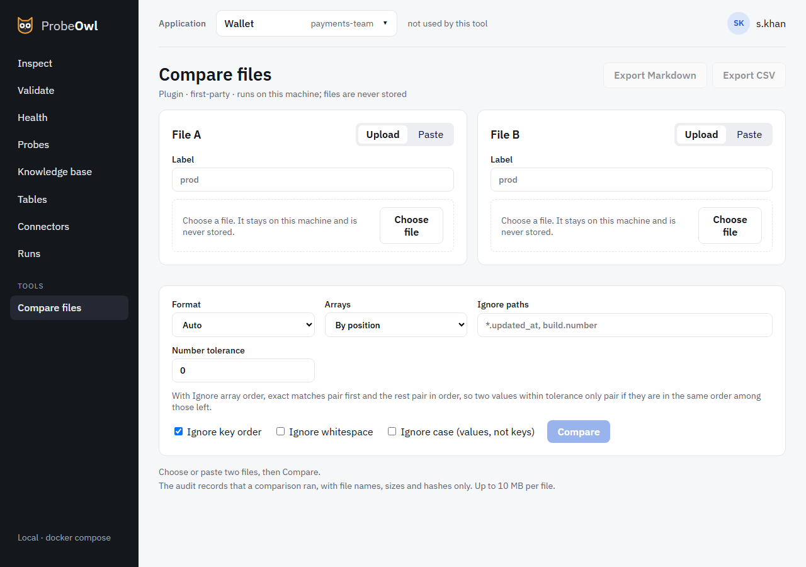

# Compare files

**Compare files** is a tool, in the sidebar under Tools. It puts two files side by side, such as a
provider's settlement file and your own export. It's a plugin, and can be turned off.

{ .screen }

Choose two files. ProbeOwl lists every difference, field by field. Values that look like personal
data are masked on screen and in the response, and are shown in full only from the file you chose,
in your own browser.
