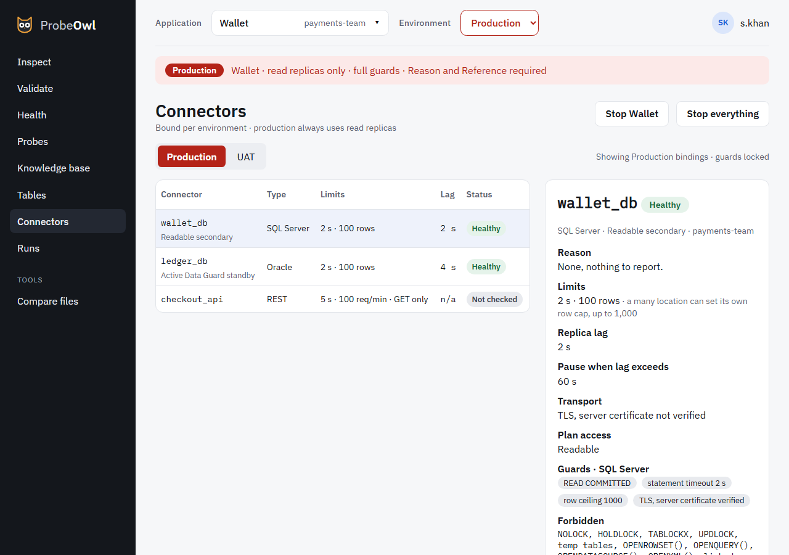

# Connectors

Connectors shows each connector of the application in the chosen environment.

{ .screen }

For each connector:

- its **type**, and in Production its **role** under its name: Read replica, Readable secondary or
  Active Data Guard standby;
- its **limits**: the row ceiling and statement timeout;
- its **replica lag**, or why it's unknown, with the grant that would show it;
- its **plan access**: whether the login can read query plans for the index check;
- its **status**: healthy, paused by the circuit breaker, or stopped by a kill switch.

**Test connection** connects once, now, and says how long it took or why it failed. Hosts, logins
and passwords never appear on this screen.

**Add connection** adds a connector, or binds one in the environment chosen in the top bar. See
[Adding a connector](../connectors.md#adding-a-connector).

## A password missing on this machine

A connector's file never holds its password, only where to find it. When this machine's keychain
doesn't have it, as when the file came from a teammate, ProbeOwl asks for it:

- on **Connectors**, under the connector, in each environment that needs it;
- on **Inspect** and **Validate**, and in the probe editor's test run, when a run needs it. Once
  it's saved, the run starts again where it was sent. If you changed the top bar's environment
  in the meantime, nothing runs: it asks *Environment changed; run again?*

**Save password** puts it straight into this machine's keychain. The page never keeps it, and
nothing reads it back. If someone else saved one meanwhile, nothing is overwritten: **Use the saved
one** carries on with it.

## Change password

**Change password**, under a connector whose password is saved, tests the new one on the saved
binding first. It replaces the saved password only if it connects. If it doesn't, the old one stays,
with the reason. When the database is down rather than the password wrong, **Save anyway** keeps
the new one regardless; until it's corrected, the connector stops working in that environment if
it's wrong.

Testing a typed password is limited to 5 tries a minute for each connector and environment, here
and in Add connection, so repeated wrong passwords can't lock the database account. The sixth
answers *too many attempts, wait a minute*, and tries nothing.

## Reload configuration

**Reload configuration** makes `owl serve` read its config folder again, so a connector, binding,
entity or probe you added or changed is loaded without a restart. It says what it loaded and which
applications and connectors changed, and it is recorded in the audit.

- The folder is checked exactly as when `owl serve` starts. If it would refuse to start, nothing
  changes: what was loaded stays loaded, and the message says what is wrong (`owl check <folder>`
  lists every error).
- It is refused while a run is running. Try again once it has finished.
- Kill switches stay as they are: they're kept in the store, not in the folder. A switch on a
  connector you removed is still on if you add the connector back.
- Plugins, the port, the store and the log file change only when `owl serve` is restarted.

`owl reload` does the same from the command line.
