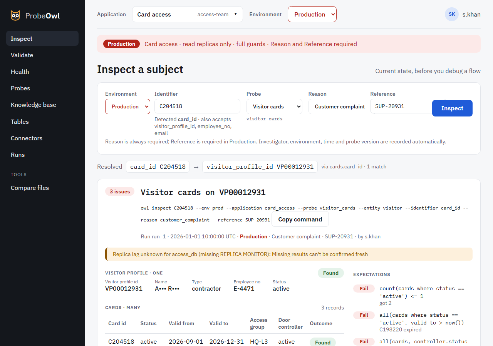

# Inspect

Inspect shows a subject's current state: everything an inspect probe reads about it, and which of
its expectations fail.

{ .screen }

1. Choose the application and environment in the top bar.
2. Type any **identifier**: a card id, a profile id, an email. ProbeOwl recognises it by its
   pattern, and says which one it detected.
3. Give a **reason**, and in Production a **reference**, then **Inspect**.

The result:

- **Resolved** shows how the identifier led to the subject: `card_id C204518 →
  visitor_profile_id VP00012931`, via `cards.card_id`.
- Each **one** location is a card showing its record's fields. Each **many** location is a table,
  one row per record, with any fan-out lookup (here, the door controller) in its own column. Rows
  with a problem are highlighted, with the reason.
- **Expectations** list each pass, fail and skip, with what was compared.
- **Evidence**, per location, shows the exact query, parameters, guards and rows.
- **Copy command** gives the `owl inspect` command that runs it again.

If the identifier finds several subjects, such as an email two visitors share, the run is
**Ambiguous**: pick one, or **Inspect both**. Personal data stays masked throughout.

From a failed run, **Compare with a healthy record** and **Suggested next steps** work as they do
on [Validate](validate.md).
