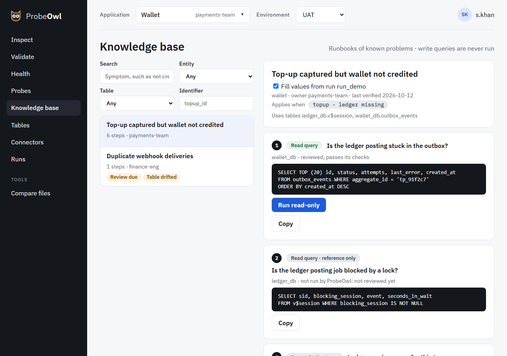

# Knowledge base

The knowledge base holds **runbooks**: the steps for a known problem, such as "top-up captured but
wallet not credited". They live in git next to the probes, and are reviewed like code.

{ .screen }

A runbook's **steps** are of six kinds:

| Step | What ProbeOwl does with it |
| --- | --- |
| Read query | Runs it, read-only and through the guards, when the runbook is opened from a run: **Run read-only** |
| Reference query | Shows it, to copy |
| Write query | Shows it to copy, headed with where it applies and what it needs. **Never run** |
| External query | Shows it, to copy into another tool |
| Manual step | A checkbox to tick, recorded |
| Probe | Runs a probe again |

Opened from a run (**Open with values**), each step's parameters are filled in from that run's
values. A value that's masked, or that has no single value in the run, stays as `:name`, and that
step can't run. Every run, copy and tick is audited.

To write one, see [Writing runbooks](../writing-runbooks.md).
