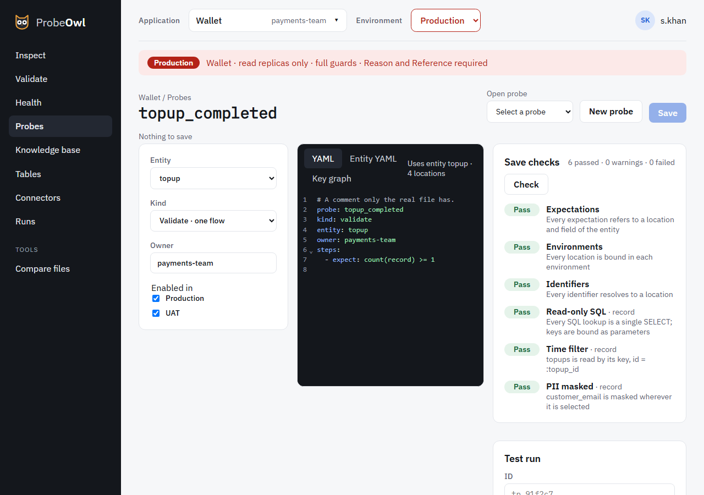

# Probe editor

The Probe editor is where probes are written, checked and tested.

{ .screen }

- **Open probe** opens a saved probe; **New probe** starts a draft; **New entity…** builds an
  entity from the imported tables (below). On the left are its entity,
  kind, owner and the environments it's enabled in. In the middle, the **YAML** tab is the probe
  itself, **Entity YAML** is its entity, and **Key graph** shows how each location gets its key.
- **Check** runs the save checks: expectations, environments, identifiers, read-only SQL, time
  filter and PII masking, and the index check against the database. Each says what passed, why
  something failed, and what would pass. See [Writing probes](../writing-probes.md#4-save-checks).
- **Test run** runs the draft on a real ID with every guard (**Run draft**). Its version starts
  with `draft:`.
- **Save** first shows the change to the file as a diff, and confirming writes it. If the file
  changed since your preview, saving is refused and you preview again.

An existing probe opens as its real file: an edit changes only the lines you change, and keeps its
comments.

## New entity

A probe checks one entity, so the first probe of a new subject type starts with **New entity…**.
It builds the entity from the tables imported in the environment chosen in the top bar, on any SQL
connector of the application, and reads no data. Import a connector's schema first, with
**Import from replica** on the [Tables](tables.md) screen.

1. **Name**: the entity's id, title and owning team.
2. **Root table**: the table one subject is a row of. Its primary key becomes the root key, which
   you can rename. A key named just `id` becomes `<entity>_id`.
3. **Locations**: the other places the subject's data lives. **Follow a key** offers the tables,
   on any connector, that share a key with a location you've added:
    - a column the catalog links to another table (`links_to`), in either direction;
    - a column with the same distinctive name, such as `provider_payment_id`;
    - a column named for a table's key, such as `cards.visitor_profile_id` for `visitor_profile.id`.

    Common names, such as `id`, `status`, `type`, `created_at` or `updated_at`, are offered only
    when the catalog links them. To link on one yourself, use **Link by columns…**: pick a column of
    a location and a column of any imported table. A location whose key column is unique holds
    one record; otherwise it's `many`, with `max_rows: 100`, or the connector's row ceiling if
    that's lower. You choose the columns each location selects.

    Every location runs the save checks as soon as it's added, and a failure shows on that
    location, with its fix where the wizard knows one. The usual one: a Transaction, Log or Audit
    table may only be read by a key or within a time window, so `cards` read by
    `visitor_profile_id` fails until the catalog calls that column a link. **Mark
    cards.visitor_profile_id as a link to visitor_profile.id** previews that change to
    `catalog.yaml`, and **Confirm in catalog.yaml** writes it, as the [Tables](tables.md) screen
    would. A failing location is never left out: fix it or remove it yourself.
4. **Identifiers**: what else can find a subject. Unique columns of a location keyed by the root
   key, such as `cards.card_id`, are ticked for you, with the reason. A unique column the catalog
   marks as PII, such as an email, is offered but not ticked; if you tick it, it's marked PII, so
   it stays masked. A pattern is optional. Only locations keyed by the root key are offered, since
   a value found there leads to its subject.
5. **Preview**: the YAML, then **Check** runs every save check on it, the index check included,
   and shows the new file as a diff. **Create** writes it.

The wizard only creates entities. To change one, open one of its probes and edit its **Entity
YAML**, so the probes are checked with it. REST locations are written by hand: see
[Writing probes](../writing-probes.md#2-locations-where-its-data-lives).
