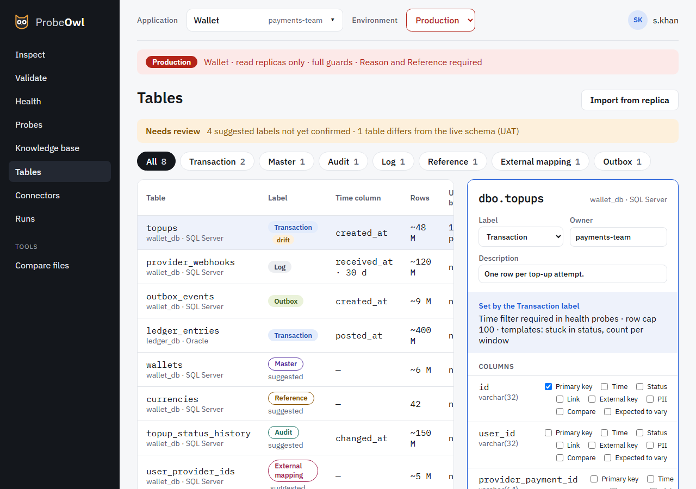

# Tables

Tables is the table catalog: every table an application's probes and runbooks read, what kind of
table it is, and which of its columns matter.

{ .screen }

- **Import from replica** reads a SQL connector's schema in one environment: tables, columns, keys,
  indexes and row estimates, never data. It does the same as `owl catalog import`.
- Each table gets a suggested **label**: Transaction, Master, Audit, Log, Reference, External
  mapping or Outbox. The label sets defaults, such as needing a time window on tables that grow.
- Mark **column roles**: primary key, time, status, link, external key, PII and compare.
- A column named for another imported table's key is suggested as a **link** to it, on any
  connector: `cards.visitor_profile_id` links to `visitor_profile.id`, and `topup_id` to
  `topups.id`. A table on the same connector wins; two on other connectors are a guess, so
  neither is suggested. A link's target is picked from the imported tables and their columns, or
  typed with **Other, not imported here…**. A Transaction, Log or Audit table may be read by a
  link column, so marking it is what lets an entity look up rows by it.
- **Confirm** writes the entry to the application's `catalog.yaml`, showing you the change first.
- Alongside, it shows **drift** between environments, such as a column only UAT has, and which
  probes read each table.
