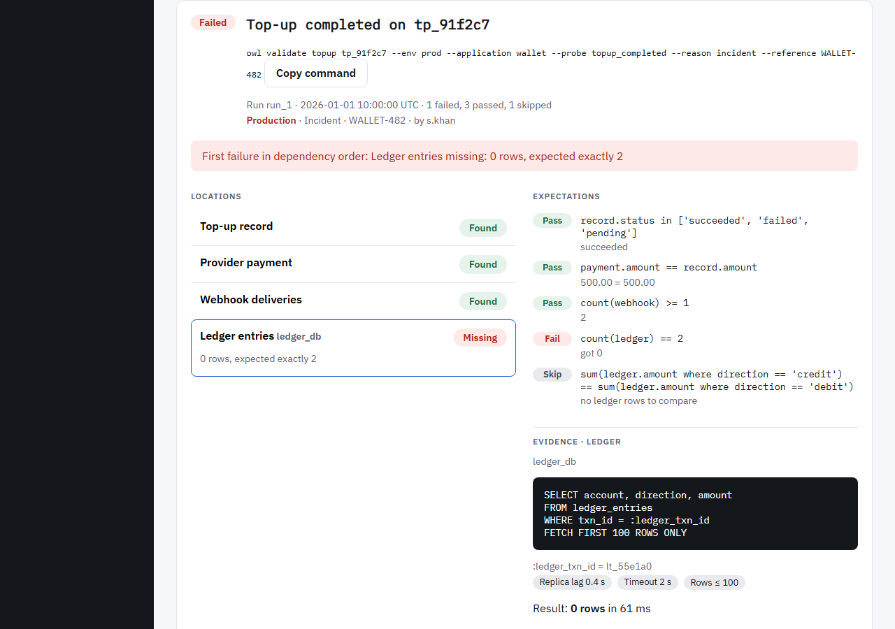

# Validate

Validate checks that a flow ran correctly for one subject, such as a top-up being captured,
confirmed by webhook and posted to the ledger.

{ .screen }

1. Choose the **entity**, type **any ID** it has (`tp_91f2c7`, or the provider's `pay_7hq2m9`),
   and choose the **probe** if there are several.
2. Fill in the **investigation record**: a reason always, a reference in Production, and notes if
   they help. A customer reference is stored masked.
3. **Validate**.

Locations fill in as they're read. Then:

- **First failure in dependency order** names the first location that wasn't Found, or the first
  failed expectation. That's the place to start.
- **Locations** list each outcome. Select one to see its **evidence**.
- **Expectations** show pass, fail or skip, with the values compared, and why a step was skipped.
- A run whose result may not be final, such as a Missing on a replica whose lag is unknown, carries
  a caveat on its status.

## Compare with a healthy record

On a failed run, **Compare with a healthy record** runs the same probe on a known-good subject:
the newest one that passes, a closer match such as **Same payment method**, or an ID you paste. Up
to three candidates are tried, each one an audited run. The differences are listed field by field,
likely causes first. Fields expected to vary, such as an amount, are shown but never highlighted.

## Suggested next steps

Runbooks whose symptoms match the run's outcomes, such as "ledger missing", are suggested.
**Open with values** opens one in the [Knowledge base](knowledge-base.md) with the run's values
filled in.
